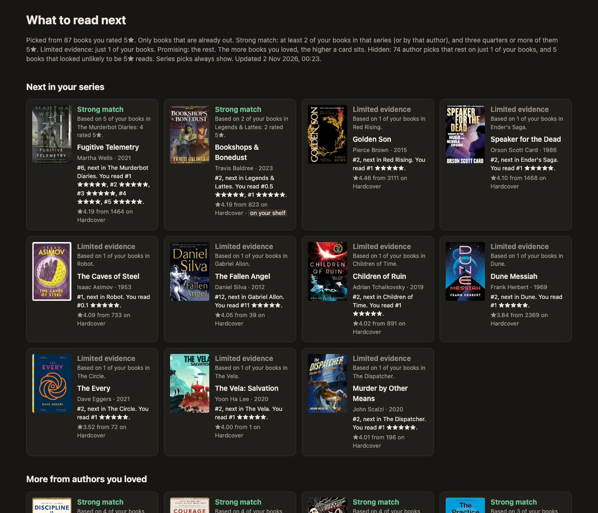

# book-recs

A local page that tells me what to read next. It looks at the books I loved in [Readwise Books](https://readwise.io/books_api) and finds two kinds of books on [Hardcover](https://hardcover.app):

- **The next book in each series I loved.** One per series: the first one after where I stopped.
- **Other books by authors I loved.** Standalones, or the first book of a series I haven't started.

It only suggests books that are already out. Each card shows a confidence %, which is the chance I'd love the book, estimated from how I rated everything else.



## Why

My books live in three places: Goodreads, Kindle (Amazon) and Readwise Books. None of them gave me an easy way to see which next books exist in the series I already loved. Readwise Books has my library and my ratings, but no catalog of series. So I added Hardcover for its catalog. I hope to drop it and use only Readwise Books once its API exposes that data.

## How it works

```
Readwise Books ──► match each book on Hardcover ──► loved = finished and rated 4.5★ or more
(my library,         (search by title + author,             │
 with my ratings)     checked against the ISBN    ┌─────────┴──────────┐
                      or the author's last name)  series I loved     authors I loved
                                                  next unread book   other books
                                                  └─────────┬──────────┘
                                         keep: already out, 4.0★+ from 50+ ratings on Hardcover
                                         add: confidence % from a model trained on my ratings
                                                            │
                                                     out/index.html
```

1. `src/readwise.mjs` pulls the whole library, ratings included.
2. `src/match.mjs` finds each book on Hardcover. Readwise has no series data, and most of my Goodreads imports have no ISBN, so this match matters most.
3. `src/recommend.mjs` picks the candidates and filters them.
4. `src/model.mjs` trains a small logistic regression on my rated books. It predicts "rated 4.5★ or more" from my ratings of the same author, my ratings of the same series, and the book's Hardcover rating.
5. `src/render.mjs` writes one static HTML page.

There are no dependencies, just Node 22's built-in `fetch`.

## Run it

1. Put your Readwise token (from [readwise.io/access_token](https://readwise.io/access_token)) in `api-key.txt`. You need Readwise Books access, or the API returns 403.
2. Put your Hardcover token (from [hardcover.app/account/api](https://hardcover.app/account/api)) in `hardcover-key.txt`, or set `HARDCOVER_TOKEN`.
3. Run `npm start`, then `npm run open`.

The first run takes about 6 minutes, because Hardcover's free API allows 60 requests a minute. After that it's quick: search results are cached in `data/hc-cache/`, and series and author data refreshes once a week.

The thresholds are constants at the top of `src/recommend.mjs` (`LIKE_MIN`, `COMMUNITY_MIN`, `COMMUNITY_MIN_RATINGS`) and `src/model.mjs` (`LOVE_MIN`).

## What my library broke

Here's the story, including the bits where I was confidently wrong. Each fix has a comment in the code.

- Hardcover's search ranks "Summary of Atomic Habits by James Clear" knock-offs above the real book, so the matcher retries with the title alone.
- God Emperor of Dune lists "Dune" as an alternate title, so exact matches on the real title win.
- Hardcover keeps duplicate books (translations, editions) and even duplicate series. A position counts as read if any copy at that position is a book I read.
- Murderbot books are filed as novellas, so a "books only" filter would hide them.

## How far to trust the %

Short answer: as a tiebreaker. Tested on my own history with 5-fold cross-validation, it ranks a book I loved above one I didn't 60% of the time (50% is a coin flip). The page prints this number for your data too. Two findings surprised me:

- Hardcover's community rating alone predicts my ratings no better than chance.
- Genre and mood tags didn't help either, so I left them out.

Nearly all the signal comes from how I rated the same author or series.

## Limits

- Goodreads ratings would be a better community signal, but Goodreads closed its API in 2020.
- Hardcover's data has gaps: some release dates are wrong, some publisher imprints show up as series, and a few books credit contributors as authors.
- It's built for one person's library on one machine. Your tokens, cache and the generated page stay local (`.gitignore` covers them).
- Hardcover's API is for personal, non-commercial use.

Claude wrote most of the code. I steered it, with care to always ground it in data: every fix above came from a run against my real library, not from a guess.
